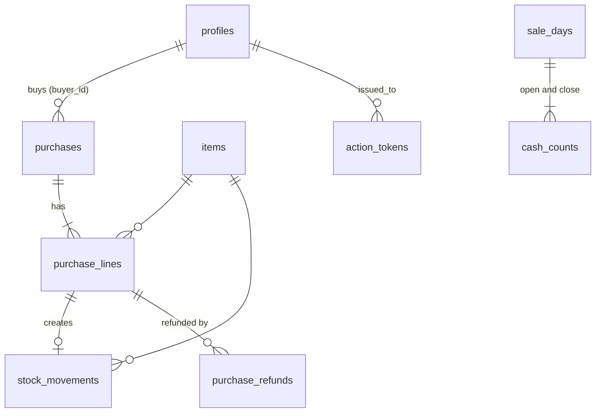

# Data model

> **Changing (2026-10-15):** The sale day part (ADR-0015, #76) is done. ADR-0016 (occasional stock counts, #74) and ADR-0017 (claims sent by the coordinator, paid by cheque, #72) still replace `action_tokens` and the weekly email; each of those tickets updates this file with its migration.

The schema is in [`supabase/migrations/`](../supabase/migrations/). It is a **reviewed draft**: it applies cleanly and passes [`supabase/tests/sale_day_flow.test.sql`](../supabase/tests/sale_day_flow.test.sql) (40 checks covering buying, the full sale day, cash maths, sign-off, locks, the ledger and treasurer links). That was checked on plain Postgres 16 with small stand-ins for Supabase's `auth`, `storage` and roles. Run `supabase test db` on the real stack as the first build step.

Conventions:
- **Money:** integer **cents** (`*_cents int`). Unit cost is fractional cents: `unit_cost_cents numeric(10,2)` (13.84 = 13.84¢).
- **Stock:** integer **pieces**, even for deal items.
- **IDs:** `uuid`. Clients may generate them so a retry does not duplicate (purchases).
- **Who/when:** `created_by`, `updated_by` default to `public.actor()`, which is the signed-in user, or the treasurer when an Edge Function redeems a signed link.
- Business maths lives in **views and functions**. The frontend reads views and calls functions; it doesn't compute money.

After writing a migration, run `pnpm db:reset` (or `pnpm db:sync` against an already-running stack) and commit the regenerated [`src/lib/database.types.ts`](../src/lib/database.types.ts) and [`supabase/schema.sql`](../supabase/schema.sql) alongside the migration. TypeScript types for anything in the database come from that generated file — never hand-written. CI's `db` job regenerates both and fails the build if they differ from what's committed.

## Overview

## Tables

| Table | Purpose | Key columns / rules |
|---|---|---|
| `settings` | One row of app settings (admin) | `float_cents` 3000 (the change float, the default left in box), `gst_rate` 0.05, `treasurer_email` |
| `profiles` | One per signed-in person | `email`, `display_name` (≤ 30, unique ignoring case), `full_name` (optional, ≤ 100; the name on their bank account, shown only in the treasurer email), `role` (volunteer / treasurer / admin), `active`. Volunteers are deactivated, never deleted. Written only through functions: `update_my_profile`, `update_team_member`, `set_member_active`, `add_volunteer` (ADR-0014). |
| `volunteer_invites` | Someone the coordinator added who has not signed in yet | `email` (one open invite each), `display_name`, `full_name` (copied to the profile), `role`, `accepted_at`. Admin only. See ADR-0011. |
| `items` | What we sell | `name`, `type` (snack / treat), `storage` (shelf / freezer), `price_cents` (null = needs a price), `bundle_size` (pieces per deal), `unit_cost_cents` (weighted average), `archived`, `version`. Price options limited by a check constraint to $1 × 1/2/3 and $2 × 1. |
| `purchases` | A receipt = a reimbursement claim | `claim_no` (SS-001…), `purchased_on`, `store`, `buyer_id`, `receipt_path`, `status` (to_pay / paid), `paid_at`, `paid_by`, `payment_ref` |
| `purchase_lines` | Receipt lines | `item_id`, `pieces`, `cost_cents` (incl. tax) |
| `purchase_refunds` | A refund on a claim line (ADR-0013). The purchase lines never change | `purchase_line_id`, `pieces` (≥ 1), `amount_cents` (> 0, incl. tax), `refunded_on`, `slip_path`, `note`, `created_by`. `id` is client-generated so a retry cannot duplicate. Audited. Written only by `refund_purchase_line()` and `undo_refund()` |
| `stock_movements` | **Append-only stock ledger** | `item_id`, `qty` (±), `reason` (purchase, sold, out, missing, damaged, found, donated, returned, correction; sign enforced), links to `purchase_line_id` or `sale_day_id`; `refund_id` on `returned` movements and on the `correction` that undoes one (no foreign key: undo deletes the refund row) |
| `sale_days` | One after-lunch sale (ADR-0015) | `sale_date` (unique), `phase` (open → closed), `selling_at`/`selling_by` (open count done), `open_note`, `close_note`, `left_in_box_cents`, `closed_at`, `closed_by` (the sign-off). **Only one open at a time.** No client writes; only the functions below |
| `cash_counts` | Cash by denomination | key (`sale_day_id`, `kind` open/close, `denom_cents` 2000, 1000, 500, 200, 100, 25, 10, 5), `qty`. All 16 rows are created with the sale day; clients update `qty` only. The open count locks once selling starts; the close count opens then; nothing changes once closed |
| `action_tokens` | One-time signed links in the treasurer email | `token_hash` (sha256; plaintext never stored), `purpose` = mark_paid, `payload`, `issued_to`, `expires_at`, `used_at`. No client access. |
| `audit_log` | Change history | `table_name`, `row_pk`, `action`, `old_data`, `new_data`, `actor`, `at`. Filled by the `audit_row()` trigger on every important table. |

Storage: private bucket **`receipts`** (second migration). Members can read and upload.

Local development data lives in [`supabase/seed.sql`](../supabase/seed.sql) and loads on `supabase db reset`: the prototype's team, its five receipts and one finished sale day, all put in through the real functions so stock, weighted-average costs, claim numbers and the sale day maths come out the way they would in production. The seeded claims have a `receipt_path` but no uploaded photo, so their receipt links do not open. The pgTAP tests clear the seed inside their transaction and start from an empty database.

## Views

All views use `security_invoker = true`, so row level security still applies.

| View | Gives you |
|---|---|
| `item_stock` | Every item column plus `on_hand` (sum of the ledger) |
| `item_overview` | What the Items tab reads: `item_stock` plus `is_new` (added in the last 30 days), who bought it last, and who edited it last (for the conflict prompt) |
| `claims` | Purchases plus `claim_label` (SS-001), `total_cents` (the receipt), `refunded_cents`, `net_cents` (receipt minus refunds; what is owed), `buyer_name`. A To pay claim at `net_cents = 0` is shown as Refunded; its `status` stays `to_pay` |
| `claim_lines` | Every purchase line with `item_name`, plus `pieces_left` and `cents_left` after refunds |
| `claim_refunds` | Each refund with its `purchase_id` and who logged it |
| `sale_day_cash` | Per sale day: `open_cents`, `close_cents`, `revenue_cents = close − open`, `left_in_box_cents`, `deposit_cents = close − left in box`, `expected_open_cents` (the previous closed sale day's left in box, by date), `open_diff_cents`, notes, who opened and closed it |
| `type_benchmarks` | Per type: what a piece usually costs, for Deal check (HANDOFF §5.4) |
| `change_history` | One row per changed field, read from `audit_log`, for the history lists: item edits (`name`, `price` as `cents/bundle`, `type`, `storage`, `archived`) and sale day `phase`. Skips unit cost, version bumps and an item's first pricing in `log_purchase` |

## Functions (the only way to do the important things)

All are `security definer`, check that the caller is an active member, and keep business rules in one place.

| Function | What it does | Guards |
|---|---|---|
| `add_volunteer(email, name, role)` | Writes the profile if that email already has an account, otherwise an invite. Returns `{"status": "added" \| "invited"}` | Admin only |
| `open_sale_day(date?)` | Creates the sale day (default today in Vancouver) and its 16 cash rows | Not in the future; one per date; one open at a time |
| `cancel_sale_day(sale_day)` | Deletes a sale day opened by mistake | Only before selling starts |
| `start_selling(sale_day, note?)` | Ends the open count: stamps `selling_at` and keeps the optional note | Open; open count above $0; once |
| `close_sale_day(sale_day, left_in_box_cents, note?)` | Records left in box and the note; the caller is the sign-off; phase → closed | Selling started; close count above $0; 0 ≤ left in box ≤ close count; guarded update so a double tap fails cleanly |
| `log_purchase(jsonb)` | One transaction: claim, new items, lines, purchase movements, weighted-average cost, optional price | Idempotent on the purchase `id`; receipt required; ≥ 1 line |
| `refund_purchase_line(id, line, pieces, amount_cents, refunded_on, slip_path, note)` | Logs a refund and a `returned` movement in one transaction | Idempotent on `id`; To pay claim only ("Already paid. Ask the treasurer."); buyer or coordinator; pieces ≤ not yet refunded ("Only N left on this line."); pieces ≤ on hand ("Only N on hand."); amount ≤ cost left on the line. Unit cost is not recalculated |
| `undo_refund(id)` | Removes the refund row (the audit log keeps it) and adds a `correction` (+) movement | To pay claim only; buyer or coordinator |
| `issue_mark_paid_tokens(interval)` | For the weekly email: one token per volunteer owed money (net above $0), issued to the treasurer. Stores the total in the payload | Service role only |
| `redeem_action_token(token, ref)` | Marks that volunteer's claims paid, recorded as the treasurer | Service role only; single use; expires; refuses if the claims' net total no longer matches the stored total (SS004). Tokens without a stored total redeem as before |

The `log_purchase` payload shape is documented in the migration above the function.

## Guards (triggers)

- **Phase rules** on `cash_counts`: rows are created with the sale day and only `qty` changes; the open count until selling starts, the close count after; **nothing once closed**. Functions bypass this by setting `snack.fn = on` for their own transaction.
- **Ledger is append-only**: update and delete raise an error, even for the service role. Fix mistakes with a `correction` movement.
- **Sign-in** (`on_auth_user_created` on `auth.users`): the first account on an empty database becomes the coordinator; otherwise an open invite for that email becomes a profile. No invite means no profile, and the app says "Ask the coordinator to add you". See ADR-0011.
- **The team keeps a coordinator**: you cannot deactivate yourself, and the last active admin cannot be demoted or deactivated.
- **Items**: `updated_at/by` stamped and `version` bumped on every update. Clients do optimistic concurrency with `.update({...}).eq('id', id).eq('version', loadedVersion)`; zero rows updated means someone else changed it, so show the conflict prompt.

## Row level security

| Who | Can |
|---|---|
| Any active member | Read everything except `action_tokens`. Edit items. Enter cash counts (phase rules apply). Add `donated` and `correction` stock movements. Call the functions above. |
| Admin | Also add and update `profiles` (no deletes), read and cancel `volunteer_invites`, and edit `settings`. |
| Treasurer | Same as a member if they ever sign in. Payments come through `redeem_action_token` via the Edge Function. |
| Nobody (clients) | Insert purchases, lines or sale days directly, change a sale day row, post sold/out/missing movements, or touch `action_tokens`. Those go through functions. |

## Realtime

The `supabase_realtime` publication includes `sale_days` and `cash_counts`. The Sale day screen subscribes and invalidates its TanStack Query keys on each change. Presence was dropped (ADR-0015).

## Weekly treasurer email (Edge Function)

1. Scheduled with Supabase Cron (pg_cron) every Monday 07:00 America/Vancouver.
2. The function (service role) reads `sale_day_cash` for last week, the `claims` view, and calls `issue_mark_paid_tokens()`.
3. It builds the email (see prototype, Buy → Claims) with links such as `https://<app>/pay?t=<token>`, attaches the CSV ledger, and sends through the email provider.
4. `/pay` is a tiny page that posts the token to a second Edge Function, which calls `redeem_action_token(token, ref)` and shows "Yuki's 2 receipts marked paid".
5. Receipt links in the email are short-lived signed URLs from the `receipts` bucket.

## What's deliberately not in the schema

Individual sales, stock counts on sale days, a lineup, kid rules, customers, payment methods, barcodes, per-flavour stock, sale/clearance prices, a healthy flag, claim approval. See `docs/adr/`.

## Things to confirm during the build

- `auth.users` inserts in the test file use only `id` and `email`; adjust if the local Supabase version needs more columns.
- In Supabase, `pgcrypto` lives in the `extensions` schema; the functions call `extensions.gen_random_bytes` and `extensions.digest`.
- Whether to add an index on `stock_movements (item_id, created_at)` once there's real data (not needed at this scale).
